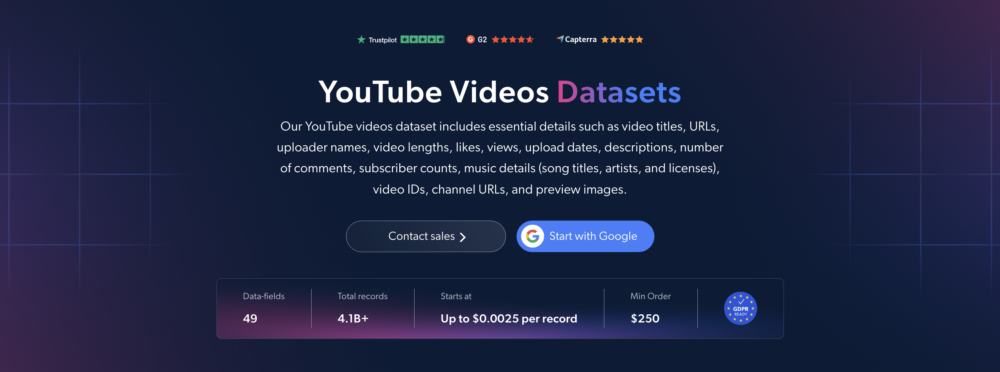

# YouTube-Videos-dataset-samples

<h2>A sample dataset of 1000 YouTube videos</h2>

<a href="https://brightdata.com/products/datasets/youtube/videos">
   
</a>

A YouTube videos dataset sample of 1000 public videos. Dataset was extracted using the <b>Bright Data API</b>.

<h2>Some of the data points that are included in the dataset:</h2>

* ```url```: URL of the YouTube video page
* ```video_id```: Unique identifier for each video
* ```title```: Title of the video
* ```description```: Description accompanying the video
* ```date_posted```: Date the video was published
* ```video_length```: Duration of the video in seconds
* ```views```: Number of video views
* ```likes```: Number of likes received by the video
* ```num_comments```: Number of comments, including replies, as displayed by YouTube
* ```youtuber```: Handle of the channel that published the video
* ```youtuber_id```: Unique identifier for the channel
* ```channel_url```: URL of the YouTube channel
* ```subscribers```: Number of subscribers to the channel
* ```verified```: Whether the channel is verified
* ```preview_image```: URL of the video's preview image
* ```post_type```: Content type, such as a standard video or YouTube Short
* ```category```: YouTube content category assigned to the video
* ```hashtags```: Hashtags found in the video title or description
* ```tags```: Tags associated with the video
* ```music```: Information about music identified in the video
* ```transcript```: Plain-text transcript from available caption tracks
* ```formatted_transcript```: Timestamped transcript segments
* ```transcript_language```: Available caption and transcript languages
* ```chapters```: Creator-defined chapter titles and start times
* ```is_sponsored```: Whether YouTube displays a declared paid-content overlay
* ```license```: URL of the video's declared license

And a lot more.

This is a sample subset which is derived from the "YouTube Videos (public data)"
dataset which includes more than <b>4,100,000,000 video records</b>.

Available dataset file formats: <b>JSON, NDJSON, JSON Lines, CSV, or Parquet. Optionally, files can be compressed to .gz</b>.

Dataset delivery type options: <b>Email, API download, Webhook, Amazon S3, Google Cloud storage, Google Cloud PubSub, Microsoft Azure, Snowflake, SFTP</b>.

Update frequency: <b>Once, Daily, Weekly, Monthly, Quarterly, Biannual, or Custom basis</b>.

Data enrichment available as an addition to the data points extracted: <b>Based on request.</b>

<b>[Get the full YouTube Videos dataset](https://brightdata.com/products/datasets/youtube/videos)</b>.

<a href="https://brightdata.com/products/datasets/youtube/videos">
</a>

<h2>What are the YouTube Videos datasets use cases?</h2>

<h3>1. Content performance analysis</h3>
Creators and marketers use YouTube videos datasets to compare views, likes and comment counts across topics, categories and video lengths. These metrics help identify top-performing content and inform future video strategies without relying solely on channel subscriber counts.

<h3>2. Competitive intelligence</h3>
Brands analyze competitors' publishing dates, video topics, tags and performance metrics to understand their content strategies. Comparing upload frequency and engagement across channels helps identify content gaps and opportunities for differentiation.

<h3>3. Transcript and topic research</h3>
Researchers analyze video transcripts, descriptions and hashtags to map topics, track brand mentions and identify recurring themes. Timestamped transcripts and chapter markers help locate relevant sections within videos and support searchable content libraries.

<h2>Free access to web scraping tools and datasets for academic researchers and NGOs</h2>

The Bright Initiative offers access to Bright Data's <b>[Web Scraper APIs](https://brightdata.com/products/web-scraper)</b> and <b>[ready-to-use datasets](https://brightdata.com/products/datasets)</b> to leading academic faculties and researchers, NGOs and NPOs promoting various environmental and social causes. You can submit an application <b>[here](https://brightinitiative.com)</b>.
